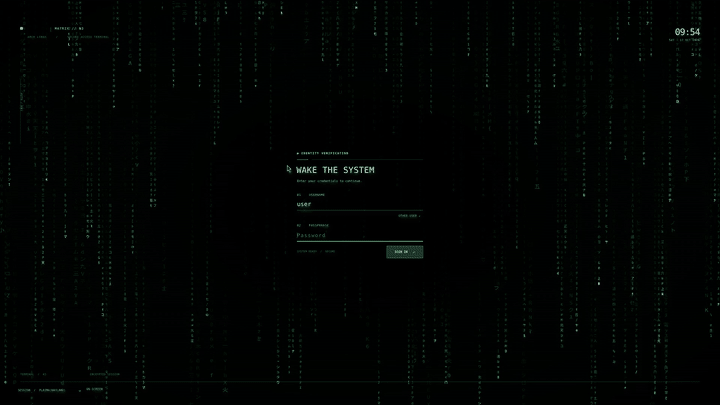

# Matrix Greeter



[Watch the 10-second SDDM demo in full resolution (MP4)](media/matrix-greeter-demo-10s.mp4?raw=1)

The video shows the SDDM theme in test mode with a moving pointer. It does not show a real login.

Matching Matrix-style themes for two distinct KDE Plasma 6 screens:

- `sddm/`: graphical login **before** a Plasma session starts. SDDM controls authentication and session choice.
- `plasma-lock/`: unlock **within** a running Plasma session, including after sleep. KDE's screen locker controls authentication.

These are two QML frontends for different host APIs, not two display managers. KDM is not used. The visual assets and shader design match; passwords always go to the host's normal authenticator. Neither theme changes PAM or the desktop panel.

## Install on Arch Linux / Plasma 6 Wayland

Install the build-time shader tool and required runtime packages:

```bash
sudo pacman -S --needed qt6-shadertools sddm kscreenlocker
```

From this repository as your **ordinary user**:

```bash
bash install.sh
```

This compiles both shaders, installs SDDM runtime files with root ownership using `sudo`, and stages the Plasma lock package for your account. It **does not activate either theme**. Existing theme directories are never overwritten. Use `bash install.sh --sddm` or `bash install.sh --lock` to stage only one component. An existing installation must be reviewed and backed up before replacement; the installer refuses to overwrite it.

Preview both before changing your real login/lock settings:

```bash
sddm-greeter-qt6 --test-mode --theme "$PWD/sddm"
bash plasma-lock/test.sh
```

Close each test window. SDDM test mode does not prove a real login; KDE lock test mode does not prove a real lock/unlock. Check the password field, keyboard, session selector on SDDM, and F12 / KDE DEFAULT on the lock screen. Do not activate a failing theme.

To activate the SDDM theme, select **Matrix Greeter** in Plasma System Settings → Login Screen (SDDM). This requires administrator authentication. To activate the Plasma lock theme, run `bash plasma-lock/activate.sh`, type `TESTED` after previewing it, then **log out and log back in** so KWin gets the new environment. Test `Meta+L` and password unlock before leaving the machine unattended. SDDM selection and Plasma lock selection are independent.

## Recovery

For the Plasma lock theme, run `bash plasma-lock/restore.sh` as the same user, then log out and back in. If the lock UI is unusable, try its F12 / KDE DEFAULT fallback or switch to a TTY with `Ctrl+Alt+F3` and run the restore script there. Do not kill KWin or weaken authentication.

For SDDM, select a known-good installed login theme in System Settings. If the graphical login is unavailable, use a TTY and inspect `/etc/sddm.conf.d/`; do not restart SDDM from an active graphical session because that ends the session. See `sddm/README.md` for details.

## Repository layout

```text
sddm/         SDDM theme, shader source, assets, build/test/install tools
plasma-lock/  Plasma lock package, shader source, assets, build/test/install/restore tools
install.sh    One staging entry point; no activation
```

The `.qsb` files are generated locally by `build.sh` and excluded from Git. Source assets and QML are tracked. SDDM installs system-wide and requires root-owned files; the lock package and KWin override are per-user. This repository is MIT-licensed (see `LICENSE`).
